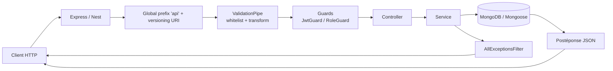
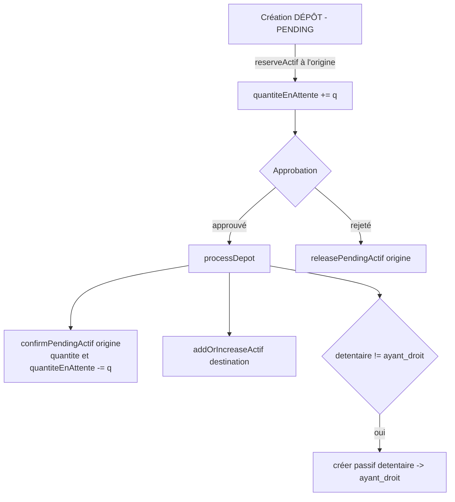

# Documentation Complète – commercegestion_back

Guide exhaustif pour les développeurs prenant en charge cette API backend.
Ce document couvre tous les aspects du projet, du dépôt à la production.

> Dépôt : `api-etokisana` (nom interne) / `commercegestion_back`
> En complément : [README.md](../README.md) et [WEBSOCKET_NOTIFICATIONS.md](../WEBSOCKET_NOTIFICATIONS.md).

---

## Table des Matières

1. Vue d'Overview du Projet
2. Installation et Setup
3. Architecture Générale
4. Structure du Projet et Fichiers
5. Modules et Endpoints (V1)
6. Modules et Endpoints (V2)
7. Modèle de Données (Schémas Mongoose)
8. Authentification et Autorisation
9. Logique Métier Comptable (Actifs / Passifs / Stock / Transactions)
10. Services Transversaux (shared)
11. Notifications WebSocket (Socket.io)
12. Sécurité, CORS et Validation
13. Configuration / Variables d'Environnement
14. Scripts et Commandes
15. Tests
16. Linting, Formatage et Conventions
17. Déploiement
18. Dépannage
19. Fonctionnalités – Fichiers et Modifications Recommandées
20. Liens Rapides

---

## 1. Vue d'Overview du Projet

- **Framework** : NestJS 11
- **Base de données** : MongoDB (replica set requis) + Mongoose 9
- **Langage** : TypeScript 5.7 (ES2023, `nodenext`)
- **Documentation API** : Swagger / OpenAPI (`@nestjs/swagger`) — multi-versions
- **Authentification** : JWT access + refresh (Passport), bcrypt
- **Emails** : `@nestjs-modules/mailer` + Handlebars, file d'attente persistée en MongoDB
- **Stockage fichiers** : MinIO (S3-compatible) avec repli local `upload/`, images optimisées via `sharp`
- **Temps réel** : Socket.io (`@nestjs/websockets` + `@nestjs/platform-socket.io`)
- **Exports** : CSV (`json2csv`), Excel (`xlsx`), PDF (`pdfkit`)
- **Sécurité / validation** : `class-validator` / `class-transformer`, filtre d'exceptions global, allowlist CORS
- **Conteneurisation** : Docker (image `node:24-alpine`, port `4243`)
- **CI/CD** : GitHub Actions → déploiement SSH avec rollback

L'API est **versionnée par URI** : `/api/v1/...` (API complète) et `/api/v2/...` (API allégée).

---

## 2. Installation et Setup

### Prérequis

- **Node.js** ≥ 18 (l'image Docker utilise Node 24)
- **npm**
- **MongoDB** ≥ 6 configuré en **replica set** (obligatoire pour les transactions Mongoose — voir §18)
- (Optionnel) **MinIO** pour le stockage objet en production

### Étapes

```bash
# 1. Cloner le dépôt
git clone https://github.com/raDominique/commercegestion_back.git
cd commercegestion_back

# 2. Installer les dépendances
npm install

# 3. Configurer les variables d'environnement
cp .env.example .env
# puis éditer .env (voir section 13)

# 4. Lancer en développement (watch)
npm run start:dev

# 5. API disponible sur http://localhost:5000
#    Swagger UI  : http://localhost:5000/swagger
```

### Scripts Disponibles (package.json)

| Script | Description |
|--------|-------------|
| `npm run build` | Build de production NestJS → `dist/` |
| `npm run start` | Démarre l'application (ts-node, sans watch) |
| `npm run start:dev` | Démarre en mode watch (rechargement automatique) |
| `npm run start:debug` | Mode debug avec watch |
| `npm run start:prod` | Démarre le build compilé (`node dist/main`) |
| `npm run format` | Formate le code avec Prettier |
| `npm run lint` | Exécute ESLint avec `--fix` |
| `npm run test` | Tests unitaires Jest |
| `npm run test:watch` | Tests unitaires en watch |
| `npm run test:cov` | Couverture de tests |
| `npm run test:e2e` | Tests end-to-end |
| `npm run test:debug` | Tests en mode debug |

---

## 3. Architecture Générale

Le projet suit l'architecture modulaire NestJS classique : un module racine compose deux modules de version, qui référencent chacun leurs modules métier.

```
src/
├─ main.ts                        # Bootstrap (pipes, filtres, CORS, prefix, Swagger, seeders)
├─ app.module.ts                  # Module racine + RouterModule (montage v1/v2)
├─ config/                        # Configuration transversale (Swagger)
├─ database/                      # Connexion MongoDB/Mongoose (module global)
├─ common/                        # Filtres, intercepteurs, logger
├─ seeders/                       # Seeders (dev only) — superadmin
├─ shared/                        # Modules partagés (mail, notifications, upload, export)
├─ v1/                            # API Version 1 (complète)
└─ v2/                            # API Version 2 (allégée)
```

### Flux d'une requête



### Points d'attention

- **Prefix global** : `app.setGlobalPrefix('api', { exclude: ['/upload'] })`.
- **Versioning URI** : activé via `app.enableVersioning({ type: VersioningType.URI })`, mais **aucun décorateur `@Version`** n'est utilisé : c'est le `RouterModule` qui fixe les segments `v1` / `v2`.
- **Validation** : `ValidationPipe({ whitelist: true, transform: true })` (les champs non déclarés sont supprimés, les DTO sont transformés).
- **Filtre d'exceptions global** : `AllExceptionsFilter` normalise les erreurs.
- **CORS** : allowlist stricte (`CORS_ALLOWLIST`) + `APP_URL`, `credentials: true`.
- **Fichiers statiques** : `/upload` est servi hors du prefix `api` (handler MinIO puis repli `express.static`).
- **Swagger et seeders** : uniquement quand `NODE_ENV !== 'production'`.
- **Rapport SMTP** : la délivrabilité SPF/DKIM/DMARC est loguée au démarrage.

---

## 4. Structure du Projet et Fichiers

### 4.1 Zone racine et configuration

| Fichier | Fonctionnalité | Modifications possibles |
|---------|---------------|-------------------------|
| `src/main.ts` | Bootstrap : port, pipes, filtre global, CORS, prefix `api`, Swagger multi-versions, seeders, route `/upload`, rapport SMTP. | Ajouter des pipes/intercepteurs globaux, ajuster CORS, modifier l'ordre de bootstrap. |
| `src/app.module.ts` | Module racine : `ConfigModule`, `MailerModule.forRootAsync`, `MailModule`, `ExportModule`, `AppModuleV1/V2` et `RouterModule.register(...)` (montage des segments v1/v2). | Ajouter un module, changer un segment de route, ajuster la config SMTP. |
| `src/config/swagger.config.ts` | `setupSwagger(app)` : construit 2 documents (v1, v2), expose `/docs/v1-json`, `/docs/v2-json` et l'UI sur `/swagger`. | Ajouter un tag, une sécurité, un endpoint JSON. |
| `src/database/database.module.ts` | Module `@Global` : `MongooseModule.forRootAsync` sur `MONGO_URI` + logs de connexion. | Ajouter des options de connexion, du pooling, des hooks. |
| `src/common/logger/logger.service.ts` / `logger.module.ts` | `LoggerService extends Logger` avec méthodes `debug/log/error/warn/verbose` préfixées par contexte. | Ajouter un transport, un niveau. |
| `src/common/filters/http-exception.filter.ts` | `AllExceptionsFilter` (`@Catch()`) : normalise en `{ status:'error', message, data:null }`. | Modifier l'enveloppe d'erreur, ajouter du logging. |
| `src/common/interceptors/transform.interceptor.ts` | `TransformInterceptor` : enveloppe `{ status:'success', message, ...data }`. ⚠️ **non enregistré globalement** actuellement. | Enregistrer globalement si l'on veut uniformiser les réponses 2xx. |
| `src/shared/helpers/notify.helper.ts` | `NotifyHelper.notify()` : audit + email selon le type (site). | Étendre les types d'événements. |
| `src/shared/interfaces/pagination.interface.ts` | `PaginationResult<T>` (page, limit, total, summary, etc.). | Ajouter des métadonnées de pagination. |
| `src/shared/shared.module.ts` | Module vide (placeholder). | — |
| `src/seeders/*` | `Seeder` interface, `seeders[]`, `runSeeders(app)`, `SuperAdminSeeder`. | Ajouter un seeder (jeux de données de dev). |
| `nest-cli.json` | `deleteOutDir: true` + copie des templates `.hbs` en assets. | Ajouter des assets à copier. |
| `tsconfig.json` / `tsconfig.build.json` | ES2023, `nodenext`, `baseUrl: ./` (imports `src/...`), décorateurs activés. | Ajouter des alias de chemins. |
| `eslint.config.mjs` / `.prettierrc` | ESLint flat + Prettier. | Ajuster les règles. |
| `Dockerfile` / `.dockerignore` | Build 3 stages (voir §17). | Modifier les étapes de build. |
| `.github/workflows/deploy.yml` | CI/CD de déploiement (voir §17). | Ajuster le déploiement. |

### 4.2 Modules métier V1 (`src/v1/`)

| Dossier | Rôle | Fichiers principaux |
|---------|------|---------------------|
| `app` | Contrôleur racine v1 + service. | `app.controller.ts`, `app.service.ts` |
| `auth` | Authentification, guards, stratégies, décorateurs, refresh tokens. | `auth.controller.ts`, `auth.service.ts`, `guards/`, `strategies/`, `decorators/` |
| `users` | Gestion utilisateurs, parrainage, KYC, vérification email. | `users.controller.ts`, `users.service.ts`, `users.schema.ts` |
| `sites` | Sites/emplacements (géolocalisation). | `sites.controller.ts`, `sites.schema.ts` |
| `products` | Produits (+ image, validation, import). | `products.controller.ts`, `products.schema.ts` |
| `cpc` | Catégories CPC (arbre, import Excel/CSV). | `cpc.controller.ts`, `cpc.schema.ts` |
| `stock` | Mouvements de stock **immédiats** (dépôt/transfert/virement/retrait). | `stock.controller.ts`, `stock.service.ts`, `stock-movement.schema.ts` |
| `actifs` | Registre des biens (stock, quantités, détenteur/ayant-droit). | `actifs.controller.ts`, `actifs.service.ts`, `actifs.schema.ts` |
| `passifs` | Registre des dettes (marchandise en dépôt). | `passifs.controller.ts`, `passifs.service.ts`, `passifs.schema.ts` |
| `transactions` | Transactions **formelles** avec approbation. | `transactions.controller.ts`, `transactions.service.ts`, `transactions.schema.ts` |
| `ledger-display` | Grand livre (actifs/passifs/mouvements, stats). | `ledger-display.controller.ts`, `ledger-display.service.ts` |
| `dashboard` | Statistiques du tableau de bord. | `dashboard.controller.ts`, `dashboard.service.ts` |
| `shop-available` | Mise en vente d'actifs. | `shop-available.controller.ts`, `shop-available.schema.ts` |
| `tenders` | Appels d'offres et soumissions (bids). | `tender.controller.ts`, `tender.schema.ts` |
| `cart` | Panier, commandes, checkout. | `cart.controller.ts`, `cart.schema.ts` |
| `exchange` | Offres d'échange d'actifs. | `exchange.controller.ts`, `exchange.schema.ts` |
| `audit` | Journal d'audit. | `audit.controller.ts`, `audit-log.schema.ts` |

### 4.3 Modules V2 (`src/v2/`)

| Dossier | Rôle | Fichiers principaux |
|---------|------|---------------------|
| `app` | Contrôleur racine v2. ⚠️ non monté (voir §6). | `app.controller.ts`, `app.module.ts` |
| `users` | Liste utilisateurs paginée + export. | `users.controller.ts`, `users.schema.ts` |
| `ledger` | Exports de grand livre. | `ledger.controller.ts` |

### 4.4 Modules partagés (`src/shared/`)

| Dossier | Rôle |
|---------|------|
| `mail` | Service d'emailing, file d'attente MongoDB, délivrabilité, 33 templates `.hbs`. |
| `notifications` | Persistance + gateway WebSocket + endpoints REST. |
| `notify` | `NotifyHelper` (audit + emails site). |
| `upload` | `UploadService` + `MinioStorageService` (repli local). |
| `export` | `ExportService` (CSV / Excel / PDF). |

---

## 5. Modules et Endpoints (V1)

- **Préfixe global** : toutes les routes sont sous `/api`.
- **Légende Guards** : `—` = public, `Auth` = `@Auth()` (JWT), `Admin` = `@AuthRole(UserAccess.ADMIN)`.
- Beaucoup de contrôleurs utilisent `@Controller()` (préfixe vide) : le chemin vient du **segment de montage** (`app.module.ts`) + le chemin du décorateur de route.

### 5.1 App (`/api/v1`)

| Méthode | Route | Guard | Description |
|---------|-------|-------|-------------|
| GET | `/api/v1` | — | Hello / healthcheck. |
| POST | `/api/v1/upload-test` | — | Upload de test (multipart, champ `file`) → URL. |

### 5.2 Auth (`/api/v1/auth`)

| Méthode | Route | Guard | Description |
|---------|-------|-------|-------------|
| POST | `/api/v1/auth/login` | — | Connexion, renvoie access + refresh token. |
| POST | `/api/v1/auth/refresh` | — | Nouveau access token à partir du refresh. |
| POST | `/api/v1/auth/logout` | — | Révoque le refresh token. |
| POST | `/api/v1/auth/verify-token` | Auth | Vérifie un JWT (header `Authorization`). |
| GET | `/api/v1/auth/profile` | Auth | Profil de l'utilisateur courant. |
| POST | `/api/v1/auth/forgot-password` | — | Envoi du lien de réinitialisation. |
| POST | `/api/v1/auth/reset-password` | — | Réinitialisation via token. |
| POST | `/api/v1/auth/change-password` | Auth | Changement de mot de passe. |

### 5.3 Users (`/api/v1/users`)

| Méthode | Route | Guard | Description |
|---------|-------|-------|-------------|
| POST | `/api/v1/users` | — | Inscription (multipart : avatar, logo, carteStat, documents, carteFiscal). |
| POST | `/api/v1/users/validate-parrain/:id` | Auth | Valide un parrainage pour un filleul. |
| GET | `/api/v1/users/get-by-id/:id` | — | Détails d'un utilisateur. |
| PATCH | `/api/v1/users/update/:id` | Auth | Mise à jour du profil (+ fichiers). |
| DELETE | `/api/v1/users/delete/:id` | Admin | Désactivation (soft delete), 204. |
| GET | `/api/v1/users/verify` | — | Vérification email par token (redirection 302). |
| PATCH | `/api/v1/users/activate/:id` | Admin | Activation manuelle du compte (KYC). |
| PATCH | `/api/v1/users/toggle-role/:id` | Admin | Bascule du rôle Admin / Utilisateur. |
| GET | `/api/v1/users/select/all` | — | Tous les utilisateurs (sans pagination). |
| GET | `/api/v1/users/me/referrals` | Auth | Filleuls de l'utilisateur courant (paginé). |
| GET | `/api/v1/users/get-by-id-parrains/:parrainId` | — | Filleuls d'un parrain (paginé). |
| GET | `/api/v1/users` | — | Liste utilisateurs (paginée / recherche). |
| GET | `/api/v1/users/export` | Auth | Export utilisateurs (excel/pdf). |

### 5.4 Sites (`/api/v1/sites`)

| Méthode | Route | Guard | Description |
|---------|-------|-------|-------------|
| POST | `/api/v1/sites` | Auth | Créer un site. |
| GET | `/api/v1/sites` | — | Liste paginée. |
| GET | `/api/v1/sites/get-by-id/:id` | — | Détail site. |
| PATCH | `/api/v1/sites/update/:id` | Auth | Mettre à jour. |
| DELETE | `/api/v1/sites/delete/:id` | Auth | Supprimer. |
| GET | `/api/v1/sites/me` | Auth | Sites de l'utilisateur (paginé). |
| GET | `/api/v1/sites/nearby` | — | Sites proches (lat/lng + rayon). |
| GET | `/api/v1/sites/select/all` | — | Tous les sites (sans pagination). |
| GET | `/api/v1/sites/by-user/:userId` | — | Sites d'un utilisateur. |
| GET | `/api/v1/sites/export` | Auth | Export (excel/pdf). |

### 5.5 Produits (`/api/v1/products`)

| Méthode | Route | Guard | Description |
|---------|-------|-------|-------------|
| POST | `/api/v1/products` | Auth | Créer un produit (image obligatoire, multipart). |
| POST | `/api/v1/products/bulk-fake` | Auth | Générer N produits factices. |
| POST | `/api/v1/products/bulk-create` | Auth | Création en masse (résolution CPC). |
| PATCH | `/api/v1/products/update/:id` | Auth | Mise à jour (image optionnelle). |
| DELETE | `/api/v1/products/delete/:id` | Auth | Supprimer. |
| PATCH | `/api/v1/products/toggle-validation/:id` | Admin | Valider / rejeter un produit. |
| PATCH | `/api/v1/products/validate-all` | Admin | Valider tous les produits en attente. |
| GET | `/api/v1/products` | Admin | Liste globale (admin). |
| GET | `/api/v1/products/me` | Auth | Mes produits. |
| GET | `/api/v1/products/get-by-id/:id` | Auth | Détail produit. |
| GET | `/api/v1/products/select-all-produits` | — | Produits validés (sélecteur). |
| GET | `/api/v1/products/export` | Auth | Export (excel/pdf). |

### 5.6 CPC (`/api/v1/cpc`)

| Méthode | Route | Guard | Description |
|---------|-------|-------|-------------|
| POST | `/api/v1/cpc` | Auth | Créer une catégorie. |
| GET | `/api/v1/cpc/select/all` | — | Toutes les catégories (id/nom/code). |
| GET | `/api/v1/cpc` | — | Liste paginée. |
| GET | `/api/v1/cpc/get-by-code/:code` | — | Catégorie par code. |
| GET | `/api/v1/cpc/get-children/:code` | — | Sous-catégories directes. |
| PATCH | `/api/v1/cpc/update/:code` | Auth | Mettre à jour. |
| DELETE | `/api/v1/cpc/delete/:code` | Auth | Supprimer. |
| POST | `/api/v1/cpc/import` | Auth | Import Excel/CSV (multipart, champ `file`). |
| GET | `/api/v1/cpc/export` | — | Export (csv/excel/pdf). |
| POST | `/api/v1/cpc/bulk-create` | Auth | Créer plusieurs catégories. |

### 5.7 Stock – mouvements immédiats (`/api/v1/stocks`)

> ⚠️ Segment **pluriel** `stocks`.

| Méthode | Route | Guard | Description |
|---------|-------|-------|-------------|
| POST | `/api/v1/stocks/depot` | Auth | Dépôt immédiat (movement DEPOT). |
| POST | `/api/v1/stocks/transfer` | Auth | Transfert vers un autre détenteur. |
| POST | `/api/v1/stocks/virement` | Auth | Virement de propriété (sans déplacement). |
| GET | `/api/v1/stocks/site-actifs/:siteId` | Auth | Actifs de l'utilisateur sur un site. |
| GET | `/api/v1/stocks/site-passifs/:siteId` | Auth | Passifs (dettes) d'un site. |
| GET | `/api/v1/stocks/deposits` | Auth | Journal des dépôts (paginé). |
| GET | `/api/v1/stocks/withdrawals` | Auth | Journal des retraits (paginé). |
| POST | `/api/v1/stocks/flag-movement/:movementId` | Auth | Signaler un mouvement suspect. |
| POST | `/api/v1/stocks/validate-movement/:movementId` | Auth | Valider un mouvement signalé. |
| GET | `/api/v1/stocks/export` | Auth | Export (excel/pdf). |

### 5.8 Actifs (`/api/v1/actifs`)

| Méthode | Route | Guard | Description |
|---------|-------|-------|-------------|
| GET | `/api/v1/actifs/get-by-ids` | Auth | Détails de plusieurs actifs/transactions (ids séparés par virgule). |
| GET | `/api/v1/actifs/get-by-id/:id` | Auth | Détail complet d'un actif. |
| GET | `/api/v1/actifs/shop-available` | Auth | Catalogue d'actifs validés vendables. |
| GET | `/api/v1/actifs/all-by-site/:siteId` | Auth | Actifs d'un site (select2). |
| GET | `/api/v1/actifs/quantite-vendable-by-site/:siteId` | Auth | Quantité vendable par produit pour un site. |
| GET | `/api/v1/actifs/my-deposits` | Auth | Actifs déposés chez des détenteurs. |
| GET | `/api/v1/actifs/export` | Auth | Export (excel/pdf). |

### 5.9 Passifs (`/api/v1/passifs`)

| Méthode | Route | Guard | Description |
|---------|-------|-------|-------------|
| GET | `/api/v1/passifs/:id` | Auth | Détail d'un passif (dette). |
| GET | `/api/v1/passifs/all-by-site/:siteId` | Auth | Passifs d'un site (select2). |
| GET | `/api/v1/passifs/export` | Auth | Export (excel/pdf). |

> ⚠️ Caveat d'ordre de déclaration : `@Get(':id')` précède `@Get('export')` ; `/passifs/export` peut être capturé par `:id` selon la résolution. À surveiller.

### 5.10 Transactions – parcours formel (`/api/v1/transactions`)

| Méthode | Route | Guard | Description |
|---------|-------|-------|-------------|
| POST | `/api/v1/transactions/deposit` | Auth | Crée un DÉPÔT **PENDING** (201). |
| POST | `/api/v1/transactions/return` | Auth | Crée un RETRAIT **PENDING** (201). |
| POST | `/api/v1/transactions/initialization` | Auth | Initialisation de stock (créée directement APPROVED). |
| POST | `/api/v1/transactions/virement-droit` | Auth | Virement de droit X→Z (exécuté immédiatement). |
| POST | `/api/v1/transactions/vente` | Auth | Crée une VENTE / échange PENDING. |
| PATCH | `/api/v1/transactions/:id/approve` | Auth | Approuve et applique les mouvements. |
| PATCH | `/api/v1/transactions/:id/reject` | Auth | Rejette et libère les réservations. |
| GET | `/api/v1/transactions/deposit-at-others/me` | Auth | Mes dépôts détenus par d'autres (sans virement). |
| GET | `/api/v1/transactions/deposit-at-others-with-virement` | Auth | Dépôts chez d'autres, virements inclus. |
| GET | `/api/v1/transactions/:id` | Auth | Détail d'une transaction. |
| GET | `/api/v1/transactions/pending/list` | Auth | Transactions à approuver. |
| GET | `/api/v1/transactions/user/:userId` | Auth | Historique d'un utilisateur. |
| GET | `/api/v1/transactions/user/:userId/export` | Auth | Export de l'historique (csv/excel/pdf). |
| GET | `/api/v1/transactions/export/all` | Auth | Export de toutes les transactions. |

### 5.11 Ledger (`/api/v1/ledger`)

| Méthode | Route | Guard | Description |
|---------|-------|-------|-------------|
| GET | `/api/v1/ledger/user/:userId` | Auth | Grand livre complet d'un utilisateur. |
| GET | `/api/v1/ledger/user/:userId/export` | Auth | Export (csv/excel/pdf). |
| GET | `/api/v1/ledger/global` | Auth | Grand livre global (paginé). |
| GET | `/api/v1/ledger/global/export` | Auth | Export global. |
| GET | `/api/v1/ledger/product/:productId` | Auth | Mouvements d'un produit (filtre user optionnel). |
| GET | `/api/v1/ledger/stock-card/:userId/:productId` | Auth | Fiche de stock détaillée. |
| GET | `/api/v1/ledger/actifs/:userId` | Auth | Mouvements d'actifs (paginé, option `group`). |
| GET | `/api/v1/ledger/passifs/:userId` | Auth | Mouvements de passifs (paginé, option `group`). |
| GET | `/api/v1/ledger/me/virements` | Auth | Grand livre des virements de l'utilisateur. |

### 5.12 Dashboard (`/api/v1/dashboard/stats-dashboard`)

| Méthode | Route | Guard | Description |
|---------|-------|-------|-------------|
| GET | `/api/v1/dashboard/stats-dashboard` | Auth | Statistiques et graphiques du tableau de bord. |

> Segment doublé volontairement : montage `dashboard` + `@Controller('stats-dashboard')`.

### 5.13 Shop (`/api/v1/shop`)

| Méthode | Route | Guard | Description |
|---------|-------|-------|-------------|
| POST | `/api/v1/shop/shop-items` | Auth | Mettre un actif en vente. |
| GET | `/api/v1/shop/shop-items` | Auth | Liste des annonces actives (paginé). |
| GET | `/api/v1/shop/shop-items/mine` | Auth | Mes annonces. |
| GET | `/api/v1/shop/shop-items/:id` | Auth | Détail d'une annonce. |
| DELETE | `/api/v1/shop/shop-items/:id` | Auth | Annuler une annonce active. |

### 5.14 Tenders (`/api/v1/tenders/tenders`)

| Méthode | Route | Guard | Description |
|---------|-------|-------|-------------|
| POST | `/api/v1/tenders/tenders` | Auth | Lancer un appel d'offres (multipart : documentPieces). |
| PATCH | `/api/v1/tenders/tenders/:id` | Auth | Modifier un appel d'offres ouvert. |
| GET | `/api/v1/tenders/tenders` | Auth | Liste (paginée, `hasBid`). |
| GET | `/api/v1/tenders/tenders/mine` | Auth | Mes appels d'offres. |
| GET | `/api/v1/tenders/tenders/:id` | Auth | Détail. |
| DELETE | `/api/v1/tenders/tenders/:id` | Auth | Annuler. |
| POST | `/api/v1/tenders/tenders/:tenderId/bids` | Auth | Soumettre une offre (multipart). |
| PATCH | `/api/v1/tenders/tenders/:tenderId/bids/:bidId` | Auth | Modifier son offre. |
| DELETE | `/api/v1/tenders/tenders/:tenderId/bids/:bidId` | Auth | Retirer son offre. |
| GET | `/api/v1/tenders/tenders/:tenderId/bids` | Auth | Offres reçues. |
| GET | `/api/v1/tenders/my-bids` | Auth | Mes soumissions. |
| PATCH | `/api/v1/tenders/tenders/:tenderId/open-sealed` | Auth | Ouvrir les plis après la date limite. |
| PATCH | `/api/v1/tenders/tenders/:tenderId/award` | Auth | Attribuer l'appel d'offres. |

> Segment doublé volontairement : montage `tenders` + routes littérales `tenders`.

### 5.15 Cart (`/api/v1/cart`)

| Méthode | Route | Guard | Description |
|---------|-------|-------|-------------|
| GET | `/api/v1/cart` | Auth | Voir mon panier (total, count). |
| POST | `/api/v1/cart/add` | Auth | Ajouter un article. |
| PATCH | `/api/v1/cart/item/:shopItemId` | Auth | Modifier la quantité. |
| DELETE | `/api/v1/cart/item/:shopItemId` | Auth | Retirer un article. |
| DELETE | `/api/v1/cart` | Auth | Vider le panier. |
| POST | `/api/v1/cart/checkout` | Auth | Valider le panier → transactions VENTE + commande. |
| GET | `/api/v1/cart/orders` | Auth | Historique des commandes (paginé). |
| GET | `/api/v1/cart/orders/:orderId` | Auth | Détail d'une commande. |

### 5.16 Exchange (`/api/v1/exchange`)

| Méthode | Route | Guard | Description |
|---------|-------|-------|-------------|
| POST | `/api/v1/exchange/offers` | Auth | Créer une offre d'échange (201). |
| GET | `/api/v1/exchange/offers` | Auth | Rechercher les offres actives (paginé, filtres). |
| POST | `/api/v1/exchange/offers/:offerId/buy` | Auth | Acheter via une offre (auto-matching). |

### 5.17 Audit (`/api/v1/audit/audit`)

| Méthode | Route | Guard | Description |
|---------|-------|-------|-------------|
| GET | `/api/v1/audit/audit/get-all-sessions` | Auth | Logs d'audit de l'utilisateur courant. |
| GET | `/api/v1/audit/audit/all` | Auth | Tous les logs (admin, paginé). |
| GET | `/api/v1/audit/audit/export` | Auth | Export (excel/pdf). |

> Segment doublé : montage `audit` + `@Controller('audit')`.

### 5.18 Notifications (`/api/v1/notifications`)

| Méthode | Route | Guard | Description |
|---------|-------|-------|-------------|
| GET | `/api/v1/notifications` | Auth | Historique paginé (page, limit, search). |
| PATCH | `/api/v1/notifications/:notificationId/read` | Auth | Marquer une notification comme lue. |
| PATCH | `/api/v1/notifications/read-all` | Auth | Marquer tout comme lu. |
| GET | `/api/v1/notifications/export` | Auth | Export (excel/pdf). |

### 5.19 Mail (`/api/v1/mail`)

| Méthode | Route | Guard | Description |
|---------|-------|-------|-------------|
| POST | `/api/v1/mail/test` | — | Envoyer un email de test. |
| GET | `/api/v1/mail/status` | — | Statistiques de la file d'envoi. |
| GET | `/api/v1/mail/deliverability` | — | Rapport SPF/DKIM/DMARC. |

---

## 6. Modules et Endpoints (V2)

Version allégée, montée sous `/api/v2`.

### 6.1 Users (`/api/v2/users`)

| Méthode | Route | Guard | Description |
|---------|-------|-------|-------------|
| GET | `/api/v2/users/all-paginated` | — | Utilisateurs paginés / recherchables / filtrés. |
| GET | `/api/v2/users/export` | — | Export (excel/pdf). |

### 6.2 Ledger (`/api/v2/ledger`)

| Méthode | Route | Guard | Description |
|---------|-------|-------|-------------|
| GET | `/api/v2/ledger/user/:userId/export` | — | Export du grand livre d'un utilisateur (csv/excel/pdf). |
| GET | `/api/v2/ledger/global/export` | — | Export du grand livre global (csv/excel/pdf). |

> ⚠️ `src/v2/app.controller.ts` existe mais **n'est pas enregistré** (`AppModuleV2` n'a pas de tableau `controllers`). Ses routes ne sont donc pas servies.

---

## 7. Modèle de Données (Schémas Mongoose)

Toutes les collections utilisent `timestamps: true` sauf mention contraire. Seul `MailJob` fixe une collection explicite (`mail_queue`).

### 7.1 User — V1 (`src/v1/users/users.schema.ts`) → `users`

| Champ | Type | Requis | Défaut | Notes |
|-------|------|--------|--------|-------|
| `userNickName` / `userName` / `userFirstname` | string | oui | — | Identité. |
| `userPassword` | string | oui | — | `select:false`, bcrypt (pre-save). |
| `userEmail` | string | oui | — | unique, lowercase. |
| `userPhone` | string | non | — | |
| `userType` | string | non | `Particulier` | `Particulier` \| `Professionnel` \| `Entreprise`. |
| `userAccess` | string | non | `Utilisateur` | `Utilisateur` \| `Admin`. |
| `userTotalSolde` | number | non | `0` | Solde. |
| `userAddress` | string | non | — | |
| `userValidated` / `userEmailVerified` | boolean | non | `false` | Validation / vérification. |
| `userMainLat` / `userMainLng` | number | non | — | Géoloc. |
| `userId` | string | non | — | ID de parrainage unique (8 car., sparse). |
| `identityCardNumber` | string | non | — | KYC. |
| `identityDocument` / `carteStat` / `carteFiscal` | string[] | non | `[]` | Fichiers. |
| `documentType` | string | non | — | `cin` \| `passport` \| `permis-de-conduire`. |
| `raisonSocial` / `nif` / `rcs` / `type` / `managerName` / `managerEmail` / `logo` | string | non | — | Infos entreprise. |
| `resetPasswordToken` / `resetPasswordExpires` | string / Date | non | `null` | Réinitialisation. |
| `parrain1ID` / `parrain2ID` / `isParrainXValidated` / `parrainXToken` | — | non | — | Parrainage. |
| `deletedAt` | Date | non | `null` | Soft delete. |

Index : `{ userEmail: 1 }` unique partiel (`deletedAt: null`), `{ userId: 1 }` unique sparse.

### 7.2 User — V2 (`src/v2/users/users.schema.ts`) → `users`

Champs : `email` (unique), `password` (select:false, bcrypt), `userType` (`BUYER|SELLER|CARRIER|WAREHOUSE_MANAGER|ADMIN`, défaut `BUYER`), `companyName`, `contactPerson`, `phone`, `address`, `taxId`, `isVerified`, `isActive`, `balance`, `deletedAt`.

> ⚠️ Les classes `User` V1 et V2 pointent toutes deux vers la collection `users`. En pratique, chaque version sert un contexte distinct.

### 7.3 UserVerificationToken (`user-verification.schema.ts`) → `userverificationtokens`

`userId` (string), `token` (string), `expiresAt` (Date).

### 7.4 RefreshToken (`refresh-token.schema.ts`) → `refreshtokens`

`userId` (ObjectId → User), `token` (unique), `expiresAt`, `revoked` (défaut `false`), `revokedAt`, `ipAddress`, `userAgent`. `timestamps` : `createdAt` uniquement.

### 7.5 AuditLog (`audit-log.schema.ts`) → `auditlogs`

`action` (`CREATE|UPDATE|DELETE|LOGIN|LOGOUT|REFRESH_TOKEN|VERIFY_EMAIL|ACTIVATE_ACCOUNT|CHANGE_ROLE|PASSWORD_RESET|PASSWORD_CHANGED`), `entityType` (`USER|SITE|PRODUCT|CPC`), `entityId`, `userId` (→ User), `previousState`, `newState`, `ipAddress`, `userAgent`. `timestamps` : champ `timestamp` uniquement.

### 7.6 Site (`sites.schema.ts`) → `sites`

`siteName`, `siteAddress`, `siteLat` (-90..90), `siteLng` (-180..180), `location` (GeoJSON `Point`, index `2dsphere`), `siteUserID` (→ User). `versionKey: false`. Middleware pré-save/update pour synchroniser lat/lng ↔ `location`.

### 7.7 Product (`products.schema.ts`) → `products`

`codeCPC`, `productName`, `productDescription`, `categoryId` (→ CpcProduct), `productCategory`, `productImage`, `productOwnerId` (→ User), `productValidation` (défaut `false`), `productVolume`, `productHauteur`, `productLargeur`, `productLongueur`, `productPoids`, `isStocker` (défaut `false`). Virtuals activés.

### 7.8 CpcProduct (`cpc.schema.ts`) → `cpcproducts`

`code` (unique), `nom`, `niveau`, `ancetres` (string[]), `parentCode`, `correspondances` (Object).

### 7.9 Actif (`actifs.schema.ts`) → `actifs`

| Champ | Type | Notes |
|-------|------|-------|
| `userId` | ObjectId → User | Propriétaire. |
| `depotId` | ObjectId → Site | Site. |
| `productId` | ObjectId → Product | Produit. |
| `quantite` | number | Quantité totale. |
| `quantiteEnAttente` | number | Réservée (défaut `0`, min 0). |
| `prixUnitaire` | number | Optionnel. |
| `isActive` | boolean | Défaut `true`. |
| `archivedAt` | Date | `null`. |
| `detentaire` | ObjectId → User | Détenteur physique. |
| `ayant_droit` | ObjectId → User | Ayant-droit (propriétaire légal). |

### 7.10 Passif (`passifs.schema.ts`) → `passifs`

`userId` (→ User), `depotId` (→ Site, nullable), `creancierId` (→ User, nullable), `productId` (→ Product), `quantite`, `quantiteEnAttente` (défaut `0`), `prixUnitaire`, `isActive`, `archivedAt`, `detentaire` (→ User), `ayant_droit` (→ User), `typePassif` (défaut `DETTE_MARCHANDISE_EN_DEPOT`).

### 7.11 StockMovement (`stock-movement.schema.ts`) → `stockmovements`

`operatorId` (→ User), `type` (`DEPOT|RETRAIT|TRANSFERT|VIREMENT_PROPRIETE`), `productId` (→ Product), `quantite`, `prixUnitaire`, `detentaire` (→ User), `ayant_droit` (→ User), `siteOrigineId` (→ Site), `siteDestinationId` (→ Site), `isValide` (défaut `false`), `flaggedBy`, `flagReason`, `flaggedAt`.

### 7.12 Transaction (`transactions.schema.ts`) → `transactions`

| Champ | Type | Notes |
|-------|------|-------|
| `transactionNumber` | string | unique (ULID). |
| `type` | enum | `DÉPÔT|RETRAIT|INITIALISATION|VENTE|VIREMENT_DROIT|ECHANGE`. |
| `status` | enum | `PENDING|APPROVED|REJECTED` (défaut `PENDING`). |
| `initiatorId` | ObjectId → User | Initiateur. |
| `recipientId` | ObjectId → User | Destinataire. |
| `productId` | ObjectId → Product | Produit. |
| `siteOrigineId` / `siteDestinationId` | ObjectId → Site | Sites. |
| `quantite` / `prixUnitaire` | number | |
| `contrepartieId` / `rapportEchange` | ObjectId → Product / number | Échange. |
| `detentaire` / `ayant_droit` | ObjectId → User | |
| `approvedAt` / `approuveurId` / `motifRejet` | — | Workflow. |
| `observations` | string | |
| `linkedStockMovementId` | ObjectId → StockMovement | Mouvement lié. |
| `metadata` / `isActive` | Object / boolean | |

Index composites : `{transactionNumber,status}`, `{initiatorId,type}`, `{recipientId,type}`, `{createdAt,status}`.

### 7.13 Notification (`notification.schema.ts`) → `notifications`

`userId` (string), `title`, `message`, `isRead` (défaut `false`).

### 7.14 ShopAvailable (`shop-available.schema.ts`) → `shopavailables`

`vendeurId` (→ User), `productId` (→ Product), `siteId` (→ Site), `actifId` (→ Actif), `quantite`, `quantiteOriginale`, `prixUnitaire`, `statut` (`ACTIVE|SOLD|CANCELLED`), `description`.

### 7.15 Cart / Order (`cart.schema.ts`)

- `CartItem` (sous-document `_id:false`) : `shopItemId` (→ ShopAvailable), `productId`, `vendeurId`, `siteId`, `productName`, `productImage`, `quantite` (min 1), `prixUnitaire`, `addedAt`.
- `Cart` → `carts` : `userId` (→ User, unique), `items` (`CartItem[]`).
- `Order` → `orders` : `userId` (→ User), `items` (`CartItem[]`), `total`, `status` (`PENDING|APPROVED|REJECTED|CANCELLED`), `transactionIds` (→ Transaction[]).

### 7.16 Tender / Bid (`tender.schema.ts`)

- `Tender` → `tenders` : `lanceurId` (→ User), `productId` (→ Product), `titre`, `description`, `quantite`, `unite`, `dateLimite`, `dateDepouillement`, `statut` (`OUVERT|EN_ATTENTE|DEPOUILLE|ATTRIBUE|ANNULE`), `siteLivraison` (→ Site), `conditionsPaiement`, `delaiLivraisonSouhaite`, `documentPieces`, `soumissionRetenue` (→ Bid), `commentaireAttribution`.
- `Bid` → `bids` : `appelOffreId` (→ Tender), `soumissionnaireId` (→ User), `prixUnitaire`, `prixTotal`, `quantite`, `delaiLivraison`, `observations`, `documentPieces`, `statut` (`EN_ATTENTE|RETENUE|REJETEE`), `estAttribue`.

### 7.17 ExchangeOffer (`exchange.schema.ts`) → `exchangeoffers`

`vendeurId`, `productAId`, `quantiteA`, `detentaireAId`, `depotAId`, `productBId`, `tauxEchange`, `acceptedDetenteurBIds` (User[]), `isActive`.

### 7.18 MailJob (`mail/schemas/mail-job.schema.ts`) → `mail_queue` (explicite)

`to` (indexé), `subject`, `template`, `context`, `status` (`pending|sending|sent|failed`), `attempts` (`0`), `maxRetries` (`3`), `lastError`, `nextAttemptAt` (indexé), `sentAt`. Index composite `{status, nextAttemptAt}`.

### 7.19 Récapitulatif des collections

`users`, `userverificationtokens`, `refreshtokens`, `auditlogs`, `sites`, `products`, `cpcproducts`, `actifs`, `passifs`, `stockmovements`, `transactions`, `notifications`, `shopavailables`, `carts`, `orders`, `tenders`, `bids`, `exchangeoffers`, `mail_queue`.

---

## 8. Authentification et Autorisation

### 8.1 JWT

- **Config** (`auth/config/jwt.config.ts`) : `JWT_SECRET` (défaut de dev), `JWT_EXPIRES_IN` (`15m`), `JWT_REFRESH_SECRET`, `JWT_REFRESH_EXPIRES_IN` (`7d`).
- **Access token** : passé dans `Authorization: Bearer <token>`.
- **Refresh token** : attendu dans le **body** (`refreshToken`) par `JwtRefreshStrategy`.

### 8.2 Stratégies

- `JwtStrategy` (`'jwt'`) → `validate()` retourne un utilisateur allégé : `userId`, `email`, `userType`, `userAccess`, `userValidated`, `userVerified`, `userIdPartager`.
- `JwtRefreshStrategy` (`'jwt-refresh'`) → vérifie le refresh token et son enregistrement valide en base.

### 8.3 Guards

| Guard | Rôle |
|-------|------|
| `JwtGuard` | Authentifie via `AuthGuard('jwt')`. Si `userValidated === false` et méthode ≠ GET → `403` (« compte non validé »). |
| `JwtRefreshGuard` | Authentifie via `AuthGuard('jwt-refresh')`. |
| `RoleGuard` | Lit les rôles attendus (`Reflector`) ; si aucun rôle requis → laisse passer ; sinon exige `roles.includes(user.userAccess)`, sinon `403`. Bloque aussi les écritures si compte non validé. |

### 8.4 Décorateurs

- `@Auth()` = `UseGuards(JwtGuard)` + `ApiBearerAuth()`.
- `@Roles(...)` = `SetMetadata('roles', ...)`.
- `@AuthRole(...roles)` = `Roles(...)` + `UseGuards(JwtGuard, RoleGuard)` + `ApiBearerAuth()` + réponse 403 documentée.

### 8.5 Refresh tokens

`RefreshTokenService` : `create(userId, expiresIn, ip, userAgent)` (`randomBytes(64)`), `revoke(token)`, `findValid(token)` (non révoqué et non expiré).

### 8.6 UserAccess

```ts
enum UserAccess { UTILISATEUR = 'Utilisateur', ADMIN = 'Admin' }
```

### 8.7 Flux disponibles

Login, refresh, logout, verify-token, profile, forgot-password, reset-password, change-password, vérification d'email (`/users/verify`) et validation KYC (`/users/activate/:id`).

---

## 9. Logique Métier Comptable (Actifs / Passifs / Stock / Transactions)

C'est le cœur du domaine. Deux registres coexistent :

- **Actifs** (`actifs`) : ce que l'on possède / détient physiquement.
- **Passifs** (`passifs`) : dettes de marchandise détenue pour le compte d'un tiers.

Chaque ligne d'actif est identifiée par `(userId, depotId, productId, detentaire, ayant_droit)`.

### 9.1 `quantite` vs `quantiteEnAttente`

- `quantite` = quantité **totale** (stock réel / dette réelle).
- `quantiteEnAttente` = portion **réservée** par un flux PENDING (n'affecte pas `quantite`).
- Quantité **disponible / vendable** = `quantite - quantiteEnAttente`.

Opérations :

| Opération | Effet |
|-----------|-------|
| `reserveActif` / `reservePassif` | `quantiteEnAttente += q` (échoue si disponible insuffisant). |
| `releasePendingActif` / `releasePendingPassif` | `quantiteEnAttente -= q`. |
| `confirmPendingActif` / `confirmPendingPassif` (origine) | `quantiteEnAttente -= q` **et** `quantite -= q`. |
| `confirmPendingActifAtDestination` | `quantiteEnAttente -= q` seulement (la quantité a déjà été provisionnée). |
| `addOrIncreaseActifEnAttente` | `quantite += q` **et** `quantiteEnAttente += q` (retour provisionné). |
| `releasePendingIncomingActif` | `quantiteEnAttente -= q` **et** `quantite -= q` (annulation du retour provisionné). |

### 9.2 Flux de la logique métier



### 9.3 Deux voies coexistent

| Voie | Endpoints | Comportement |
|------|-----------|--------------|
| **Immédiate** | `/api/v1/stocks/*` | Mutation synchrone des actifs/passifs, **sans approbation** ; crée un `StockMovement` pour traçabilité. |
| **Formelle** | `/api/v1/transactions/*` | Crée une `Transaction` `PENDING`, utilise les réservations `quantiteEnAttente`, et n'applique les mouvements qu'à l'approbation. |

La voie formelle DÉPÔT converge vers la voie immédiate : `applyDepositMovements` appelle `stockService.createMovement(..., DEPOT)`, donc les deux partagent `processDepot`.

### 9.4 Types et statuts

```ts
// transactions.schema.ts
enum TransactionType { DÉPÔT, RETRAIT, INITIALISATION, VENTE, VIREMENT_DROIT, ECHANGE }
enum TransactionStatus { PENDING, APPROVED, REJECTED }
enum MovementType { ACTIF, PASSIF } // type de ligne du grand livre

// stock-movement.schema.ts
enum MovementType { DEPOT='DEPOT', RETRAIT='RETRAIT', TRANSFERT='TRANSFERT', VIREMENT='VIREMENT_PROPRIETE' }
```

### 9.5 Ordre des opérations à l'approbation

Dans `approveTransaction` :

1. Chargement de la transaction (`findById`), contrôle `status === PENDING`.
2. Affectation **en mémoire** `status = APPROVED`, `approuveurId`, `approvedAt`.
3. `applyTransactionMovements(transaction)` → applique les mouvements (dépôt/retrait/initialisation/vente).
4. `transaction.save()` → **persiste** le statut APPROVED et `linkedStockMovementId`.

> ⚠️ Point sensible : le statut est persisté **après** l'application des mouvements. Si l'étape 3 échoue en cours de route (ex. site supprimé, échec de sauvegarde d'un mouvement), le statut APPROVED n'est pas persisté, mais des mouvements partiels ont pu l'être. À traiter via une transaction Mongoose (`session`) ou un rollback explicite.

À l'inverse, `rejectTransaction` persiste `REJECTED` **avant** de libérer les réservations.

Les types `INITIALISATION` et `VIREMENT_DROIT` sont créés directement `APPROVED` (pas d'étape d'approbation). `ECHANGE` est déclaré mais **non traité** dans `applyTransactionMovements`.

---

## 10. Services Transversaux (shared)

### 10.1 Mail (`src/shared/mail/`)

- **`MailService`** : construction des emails métier, délègue à la file d'attente. Lit `APP_NAME`, `APP_URL`, `FRONT_URL`.
- **`MailQueueService`** : file durable persistée dans `mail_queue` (MongoDB).
  - Config : `MAIL_SEND_DELAY_MS` (défaut 300), `MAIL_MAX_RETRIES` (défaut 3), `ADMIN_EMAIL`.
  - Workder séquentiel unique, backoff exponentiel `1000 * 2^(attempts-1)`, récupération des jobs bloqués en `sending` au démarrage, alerte admin en échec définitif, drain sur `onModuleDestroy`.
  - API : `enqueue(payload)`, `getStats()`, `queueSize`.
- **`MailDeliverabilityService`** : vérifie SPF/DKIM/DMARC via DNS et logue un rapport.
- **`MailController`** : `POST /mail/test`, `GET /mail/status`, `GET /mail/deliverability`.
- **Templates** : 33 fichiers `.hbs` (comptes, produits, sites, transactions, appels d'offres, parrainage, mots de passe, mouvements signalés).

### 10.2 Notifications (`src/shared/notifications/`)

- **`NotificationsService`** :
  - `notifyUser(userId, title, message)` : sauvegarde une `Notification` puis émet `notification` vers `user_{userId}`.
  - `notifyAllAdmins(title, message, data?)` : émet `admin_event` vers `admin_room` (non persisté).
  - `getUserNotifications`, `markAsRead`, `markAllAsRead`, `exportAll`.
- **`NotificationsGateway`** : `@WebSocketGateway({ cors: { origin: '*' } })`. Voir §11.

### 10.3 Notify helper (`src/shared/notify/`)

`NotifyHelper.notify(options)` : écrit un log d'audit puis envoie l'email correspondant (types site CREATE/UPDATE/DELETE).

### 10.4 Upload (`src/shared/upload/`)

- **Stratégie** : MinIO (S3-compatible) avec **repli local** dans `upload/`.
- `UploadService.saveFile(file, destFolder)` : nom aléatoire hex 16 octets, BOM pour CSV, images redimensionnées (largeur 1024 → JPEG q80 via `sharp`), retourne `${APP_URL}/upload/<folder>/<name>`.
- `MinioStorageService` : activé si `MINIO_ENDPOINT` + clés + bucket définis ; sinon écrit en local. `get()` sert MinIO en priorité, puis le fichier local.
- `multer.memory.ts` : `memoryStorage()`, limite **5 Mo**.
- `UploadModule` est `@Global`.

### 10.5 Export (`src/shared/export/`)

`ExportService` : `exportCSV` (json2csv), `exportExcel` (xlsx), `exportPDF` (pdfkit, A4), `toStreamableFile()`. Convention d'endpoint : `GET .../export?format=excel|pdf` (ou `csv`).

---

## 11. Notifications WebSocket (Socket.io)

### 11.1 Connexion

```javascript
const socket = io('https://api.commercegestion.online', {
  query: {
    userId: '69b3ba868559353c9a3967f9', // ObjectId utilisateur
    userAccess: 'Utilisateur',          // 'Utilisateur' | 'Admin'
  },
  transports: ['websocket', 'polling'],
});
```

### 11.2 Rooms automatiques

- `user_{userId}` : room privée (notifications personnelles).
- `admin_room` : room partagée des admins (si `userAccess === 'Admin'`).

### 11.3 Événements serveur

| Événement | Description |
|-----------|-------------|
| `notification` | Création / approbation / rejet de transaction. |
| `admin_event` | Alertes système (admin uniquement). |
| `notification_read` | Une notification a été lue (`{ notificationId }`). |
| `notifications_read_all` | Toutes les notifications lues (`{ updatedCount }`). |

### 11.4 Payload `notification`

```typescript
{
  _id: ObjectId,
  userId: string,
  title: string,        // ex: "Nouveau Dépôt"
  message: string,
  isRead: false,
  createdAt: Date,
}
```

### 11.5 Intégration frontend

Voir [WEBSOCKET_NOTIFICATIONS.md](../WEBSOCKET_NOTIFICATIONS.md) pour le détail (hook React, filtrage lu/non-lu, synchronisation multi-onglets).

### 11.6 Déploiement Socket.io

- CORS `origin: '*'` (à restreindre en production).
- Reverse proxy nginx : `proxy_http_version 1.1` + headers `Upgrade` / `Connection: upgrade`.
- Pas de Redis requis pour une instance unique ; adapter Redis nécessaire pour le scaling horizontal.

---

## 12. Sécurité, CORS et Validation

- **CORS** : seule une origine présente dans `CORS_ALLOWLIST` (séparée par virgule) ou égale à `APP_URL` est acceptée ; `credentials: true` ; méthodes `GET, HEAD, PUT, PATCH, POST, DELETE` ; en-têtes autorisés `Content-Type, Accept, Authorization`.
- **Validation globale** : `ValidationPipe({ whitelist: true, transform: true })` — les propriétés non déclarées dans les DTO sont retirées.
- **Filtre global** : `AllExceptionsFilter` → `{ status: 'error', message, data: null }`.
- **Mots de passe** : hachés avec bcrypt (hook pre-save), jamais sélectionnés par défaut (`select: false`).
- **Secrets** : uniquement via variables d'environnement / secrets GitHub ; aucun secret en dur en production.
- **Comptes non validés** : les écritures sont bloquées (`JwtGuard` / `RoleGuard`).
- **Uploads** : noms d'objets aléatoires, protection contre la traversée de chemin, taille limitée à 5 Mo.

---

## 13. Configuration / Variables d'Environnement

Créer un fichier `.env` à la racine (modèle : `.env.example`).

| Variable | Description | Exemple |
|----------|-------------|---------|
| `PORT` | Port d'écoute HTTP. | `5000` |
| `MONGO_URI` | URI MongoDB (replica set). | `mongodb://localhost:27017/commercegestion?replicaSet=rs0` |
| `NODE_ENV` | Environnement (`development` / `production`). Swagger + seeders si ≠ production. | `development` |
| `JWT_SECRET` | Secret access token. | `your_jwt_secret_key_change_in_production` |
| `JWT_EXPIRES_IN` | Durée access token. | `15m` |
| `JWT_REFRESH_SECRET` | Secret refresh token. | `your_jwt_refresh_secret_key_change_in_production` |
| `JWT_REFRESH_EXPIRES_IN` | Durée refresh token. | `7d` |
| `SMTP_HOST` / `SMTP_PORT` / `SMTP_USER` / `SMTP_PASS` | Configuration SMTP. | `smtp.example.com` / `587` |
| `SMTP_FROM` / `SMTP_FROM_NAME` | Expéditeur. | `no-reply@...` / `Etokisana` |
| `SMTP_SECURE` | TLS (`true`/`false`). | `true` |
| `MAIL_SEND_DELAY_MS` | Délai entre envois (ms). | `300` |
| `MAIL_MAX_RETRIES` | Tentatives max avant abandon. | `3` |
| `APP_NAME` | Nom de l'application (emails). | `CommerceGestion` |
| `APP_URL` | URL publique de l'API (liens, `/upload`). | `https://api.commercegestion.online` |
| `FRONTEND_URL` / `FRONT_URL` | URLs du frontend (liens emails). | `https://commercegestion.online` |
| `MINIO_ENDPOINT` / `MINIO_PORT` / `MINIO_SSL` | Connexion MinIO. | `localhost` / `9000` / `false` |
| `MINIO_ACCESS_KEY` / `MINIO_SECRET_KEY` / `MINIO_BUCKET` | Identifiants et bucket MinIO. | `minioadmin` / `...` / `commercegestion-uploads` |
| `ADMIN_EMAIL` | Email d'alerte admin. | `admin@example.com` |
| `CORS_ALLOWLIST` | Origines autorisées (séparées par virgule). | `http://localhost:3000,https://commercegestion.com` |
| `SUPERADMIN_EMAIL` / `SUPERADMIN_PASSWORD` | Compte super-admin (seeder, dev). | `superadmin@commercegestion.com` / `...` |

> L'exécution `npm run start:dev` / `start` lance l'application ; `start:prod` exécute `dist/main`.

---

## 14. Scripts et Commandes

Voir §2 pour la table complète des scripts `package.json`. Commandes fréquentes :

```bash
# Développement avec rechargement
npm run start:dev

# Build puis exécution production
npm run build
npm run start:prod

# Linting et formatage
npm run lint
npm run format

# Tests
npm run test
npm run test:e2e
npm run test:cov
```

---

## 15. Tests

- Framework : **Jest** (unitaire + e2e).
- Lancement : `npm run test` / `npm run test:e2e` / `npm run test:cov`.
- **28 fichiers `*.spec.ts`** couvrant notamment : `app`, `auth`, `users`, `sites`, `products`, `cpc`, `stock`, `actifs`, `passifs`, `transactions`, `ledger-display`, `dashboard`, `audit`, `notifications`, `mail`, `mail-queue`, `upload`, `v1/users`, `v2/users`, `v2/app`.
- Couverture disponible dans `coverage/`.

> État : beaucoup de specs sont des squelettes générés par Nest CLI. La couverture réelle du domaine comptable reste limitée.

---

## 16. Linting, Formatage et Conventions

- **ESLint** : flat config (`eslint.config.mjs`) — `@eslint/js` + `typescript-eslint` (`recommendedTypeChecked`) + Prettier.
  - `sourceType: 'commonjs'`.
  - `no-explicit-any: off`, `no-floating-promises: warn`, `no-unsafe-argument: warn`, `prettier/prettier: error` (`endOfLine: auto`).
- **Prettier** (`.prettierrc`) : `singleQuote: true`, `trailingComma: all`.
- **TypeScript** : cible ES2023, module `nodenext`, `strictNullChecks: true`, `noImplicitAny: false`, imports via `baseUrl: ./` (ex. `import ... from 'src/...'`).
- **Conventions NestJS** : un module par domaine (`*.module.ts`, `*.controller.ts`, `*.service.ts`), DTO dans `dto/`, schéma Mongoose dans `*.schema.ts`.
- **Commits** : préfixes `feat:` / `fix:` en anglais, descriptions détaillées, commits atomiques.

---

## 17. Déploiement

### 17.1 Dockerfile (3 stages)

| Stage | Base | Action |
|-------|------|--------|
| `base` | `node:24-alpine` | Dépendances de build natives (`gcc g++ make python3 cairo-dev pango-dev jpeg-dev giflib-dev librsvg-dev`). |
| `builder` | `base` | `npm ci` (cache npm), `COPY .`, `npm run build`, `npm prune --omit=dev`. |
| final | `node:24-alpine` | Libs runtime (`cairo pango jpeg giflib librsvg tini`), user non-root `appuser`, copie `node_modules` + `dist` + `package.json`, crée `upload/`. |

- **EXPOSE 4243**, `ENTRYPOINT ["/sbin/tini","--"]`, `CMD ["node","dist/main"]`.

### 17.2 CI/CD (`.github/workflows/deploy.yml`)

- **Déclencheur** : push sur `main` + `workflow_dispatch`.
- **Cible** : serveur distant via `appleboy/ssh-action@v1.0.3`.
- **Image / conteneur** : `commercegestion-api`, tag = `github.run_number`, port `4243`.
- **Réseau MinIO** : `commercegestion` ; conteneur MinIO `minio` (endpoint interne `minio:9190`, SSL `false`) ; bucket `commercegestion-uploads`.
- **Rollback** : l'ancien conteneur est renommé `commercegestion-api_backup` avant démarrage du nouveau ; si le nouveau ne démarre pas après `sleep 15`, l'ancien est restauré et le job échoue.
- **Volume** : `commercegestion-api_upload:/app/upload`.
- **Secrets GitHub requis** : `MONGO_URI_ETOKISANA`, `JWT_SECRET_E_TAKALO`, `JWT_REFRESH_SECRET_E_TAKALO`, `SMTP_*_E_TAKALO`, `ADMIN_EMAIL_E_TAKALO`, `SUPERADMIN_*_E_TAKALO`, `MINIO_ACCESS_KEY`, `MINIO_SECRET_KEY`, `SSH_HOST`, `SSH_PORT`, `SSH_USER`, `SSH_PRIVATE_KEY`.
- **Environnement non secret** : `APP_URL=https://api.commercegestion.online`, `APP_NAME=Etokisana`, `CORS_ALLOWLIST`, `FRONTEND_URL`/`FRONT_URL=https://commercegestion.online`.
- Fin de script : `docker image prune -a -f`.

### 17.3 Socket.io / nginx

Voir §11.6 : prévoir `proxy_http_version 1.1` et les headers `Upgrade` / `Connection`.

---

## 18. Dépannage

### 18.1 Transactions MongoDB : « Transaction numbers are only allowed on a replica set member or mongos »

MongoDB doit tourner en **replica set**. Configurez `replSetName: rs0`, démarrez puis `rs.initiate(...)`, et utilisez `MONGO_URI=...?replicaSet=rs0`. Voir le README pour les procédures Windows/macOS détaillées.

### 18.2 CORS : « Not allowed by CORS »

Ajoutez l'origine exacte dans `CORS_ALLOWLIST` (ou vérifiez `APP_URL`). Le schéma (`http`/`https`) et le port comptent.

### 18.3 Uploads / MinIO

Si `MINIO_ENDPOINT`/clés/bucket ne sont pas définis, les fichiers vont dans `upload/` (repli local). En production, assurez-vous que le conteneur `minio` est joignable sur le réseau Docker.

### 18.4 Erreur de compilation liée à `setupSwagger`

`src/main.ts` appelle `setupSwagger(app, [...])` avec deux arguments alors que `src/config/swagger.config.ts` n'expose actuellement qu'un seul paramètre. Aligner la signature (ou l'appel) avant build.

### 18.5 Build / `deleteOutDir`

`nest-cli.json` a `deleteOutDir: true` : chaque `npm run build` supprime `dist/`. Éviter de s'appuyer sur des artefacts partiels.

### 18.6 Port déjà utilisé

Changer `PORT` dans `.env` (ou le mapping Docker).

### 18.7 Connexion MongoDB refusée

Vérifier que MongoDB est démarré et que `MONGO_URI` est correct.

---

## 19. Fonctionnalités – Fichiers et Modifications Recommandées

| Fichier / dossier | Modifications courantes |
|-------------------|-------------------------|
| `src/main.ts` | Ajouter un pipe/intercepteur global, ajuster CORS ou le prefix. |
| `src/app.module.ts` | Enregistrer un nouveau module ou changer un segment de route. |
| `src/config/swagger.config.ts` | Ajouter un tag/sécurité, corriger la signature `setupSwagger`. |
| `src/database/database.module.ts` | Options de connexion, pooling, hooks. |
| `src/common/logger/*` | Nouveaux niveaux / transports. |
| `src/common/filters/http-exception.filter.ts` | Forme de l'enveloppe d'erreur. |
| `src/common/interceptors/transform.interceptor.ts` | Enregistrer globalement pour uniformiser les succès. |
| `src/seeders/superadmin.seeder.ts` | Compte super-admin par défaut. |
| `src/v1/auth/**` | Guards, stratégies, décorateurs, flux (forgot/reset). |
| `src/v1/users/**` | Champs KYC, parrainage, validation de compte. |
| `src/v1/sites/**` | Géolocalisation, index `2dsphere`. |
| `src/v1/products/**` | Validation, import/export, upload image. |
| `src/v1/cpc/**` | Import Excel/CSV, arbre de catégories. |
| `src/v1/stock/**` | Mouvements immédiats, journal, flag. |
| `src/v1/actifs/**` | Réservations, confirmations, quantités vendables. |
| `src/v1/passifs/**` | Dettes, créanciers, réservations. |
| `src/v1/transactions/**` | Workflow d'approbation, notifications, exports. |
| `src/v1/ledger-display/**` | Grand livre, fiche de stock, regroupement (`group`). |
| `src/v1/dashboard/**` | Statistiques et graphiques. |
| `src/v1/shop-available/**` | Mise en vente d'actifs. |
| `src/v1/tenders/**` | Appels d'offres, plis scellés, attribution. |
| `src/v1/cart/**` | Panier, checkout, commandes. |
| `src/v1/exchange/**` | Offres d'échange, taux. |
| `src/v1/audit/**` | Journalisation, exports. |
| `src/shared/mail/**` | Templates, file d'attente, délivrabilité. |
| `src/shared/notifications/**` | Notifications REST + WebSocket. |
| `src/shared/upload/**` | MinIO, options `sharp`, limites Multer. |
| `src/shared/export/**` | Formats d'export CSV/Excel/PDF. |
| `.github/workflows/deploy.yml` | Déploiement, rollback, secrets. |
| `Dockerfile` | Étapes de build, port, user non-root. |

---

## 20. Liens Rapides

| Ressource | Chemin |
|-----------|--------|
| README (installation, dépannage replica set) | `README.md` |
| WebSockets Notifications | `WEBSOCKET_NOTIFICATIONS.md` |
| Swagger UI (dev) | `/swagger` |
| Swagger JSON v1 / v2 | `/docs/v1-json` · `/docs/v2-json` |
| Exemple d'environnement | `.env.example` |
| Modèle frontend (référence de style) | `DOCUMENTATION-frontend.md` |
| Déploiement | `.github/workflows/deploy.yml` |
| Conteneurisation | `Dockerfile` |

---

<p align="center">Documentation de passation – commercegestion_back</p>
