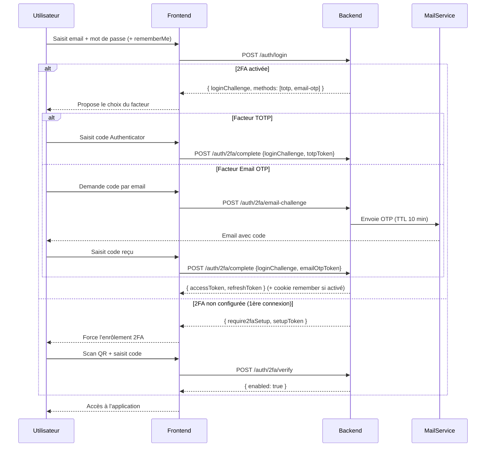

# Renforcement de sécurité — Authentification 2FA (TOTP + OTP email + Remember me)

## Diagramme de séquence (Mermaid)

## 1. Flux cible
1. `POST /auth/login` (email + password)
   - Si 2FA activée → `{ loginChallenge, methods: ["totp","email-otp"] }` (session intermédiaire, TTL 5 min).
   - Si 2FA non configurée → `require2faSetup` + `setupToken`.
2. Choix du facteur (à la GitHub) :
   - **TOTP** : `POST /auth/2fa/complete` avec `{ loginChallenge, totpToken }`.
   - **OTP email** : `POST /auth/2fa/email-challenge` (envoi code TTL 10 min, max 3 renvois/15 min) puis `POST /auth/2fa/complete` avec `{ loginChallenge, emailOtpToken }`.
3. `POST /auth/2fa/complete` : détruit le `loginChallenge`, émet les tokens JWT + refresh.
4. **Remember me** : `rememberMe: boolean` dans `POST /auth/login`. Si actif → refresh token persistant (30 j, cookie httpOnly). Sinon TTL court (24 h) + cookie de session.

## 2. Sécurité
- `loginChallenge` usage unique, TTL 5 min, invalidé après 3 échecs.
- Email OTP : code à 6 chiffres, TTL 10 min, invalidation du code précédent, rate limiting sur la régénération.
- Audit : `2FA_CHOSEN_METHOD`, `2FA_EMAIL_CODE_SENT`, `2FA_FAILED`, `LOGIN_REMEMBER_ME`.
- Facteur email activable uniquement si email vérifié.
- Revocation des refresh tokens à l'activation/désactivation de la 2FA.

## 3. Endpoints
- `POST /auth/login` → `{ loginChallenge, methods }` ou `{ require2faSetup, setupToken }`
- `POST /auth/2fa/complete` → `{ accessToken, refreshToken }`
- `POST /auth/2fa/email-challenge` → `{ sent: true }`
- `POST /auth/2fa/enable`, `/verify`, `/disable` (comme documenté dans 2fa-totp.md)

## 4. Remember me
- `LoginDto.rememberMe?: boolean`
- Cookie httpOnly + Secure + SameSite=Strict
- TTL refresh token : 30 j si remember, sinon 24 h
- Révocation possible côté serveur (logout all / changement de mot de passe)

## 5. Phases de mise en œuvre (case à cocher)

### Phase 1 — Login à 2 étapes (sans renvoyer le mot de passe)
- [x] `AuthService.login` : si 2FA activée → renvoyer `{ loginChallenge, methods }` (token interne TTL 5 min).
- [x] `POST /auth/2fa/complete` : valider le facteur choisi puis émettre les tokens.
- [x] `LoginDto` : conserver `email/password`, ajouter `totpToken?` et `emailOtpToken?`.
- [x] Tests unitaires + Swagger.

### Phase 2 — Choix du facteur (TOTP / OTP email)
- [x] `POST /auth/2fa/email-challenge` : code OTP 6 chiffres, TTL 10 min, max 3 renvois/15 min.
- [x] `POST /auth/2fa/complete` : accepter `totpToken` **ou** `emailOtpToken`.
- [x] Audit : `2FA_CHOSEN_METHOD`, `2FA_EMAIL_CODE_SENT`, `2FA_FAILED`.

### Phase 3 — Codes de secours + chiffrement du secret
- [x] 8 codes de secours à l'activation (hashés), renvoyés une seule fois.
- [x] Chiffrement du secret au repos (AES-256-GCM).
- [x] Endpoint `POST /auth/2fa/use-backup-code`.

### Phase 4 — Rate limiting & anti-rejeu
- [x] Rate limit sur `verify`, `complete`, `email-challenge`, `use-backup-code`, `disable` (5 / 15 min).
- [x] Anti-rejeu TOTP (mémorisation du dernier code par utilisateur).
- [x] Verrouillage temporaire après 3 échecs.

### Phase 5 — Remember me
- [x] `LoginDto.rememberMe?: boolean`.
- [x] Refresh token persistant (30 j) vs court (24 h).
- [x] Révocation à la déconnexion / changement de mot de passe / réinitialisation.

### Phase 6 — 2FA obligatoire à la première connexion
- [x] Flag `require2faSetup` + `setupToken` à la première connexion.
- [x] Guard JWT bloquant l'accès métier tant que `twoFactorEnabled === false`.
- [x] Audit : `2FA_FORCED_SETUP`.

> Chaque phase est indépendante et peut être validée (tests + Swagger) avant de passer à la suivante.
