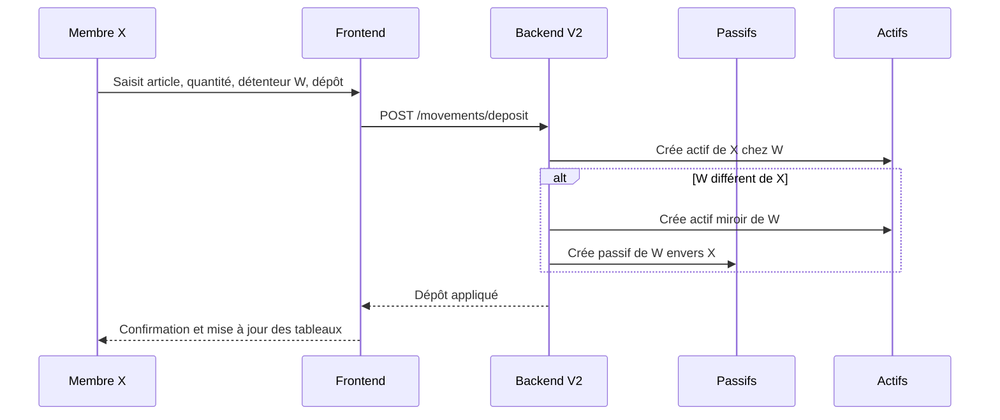
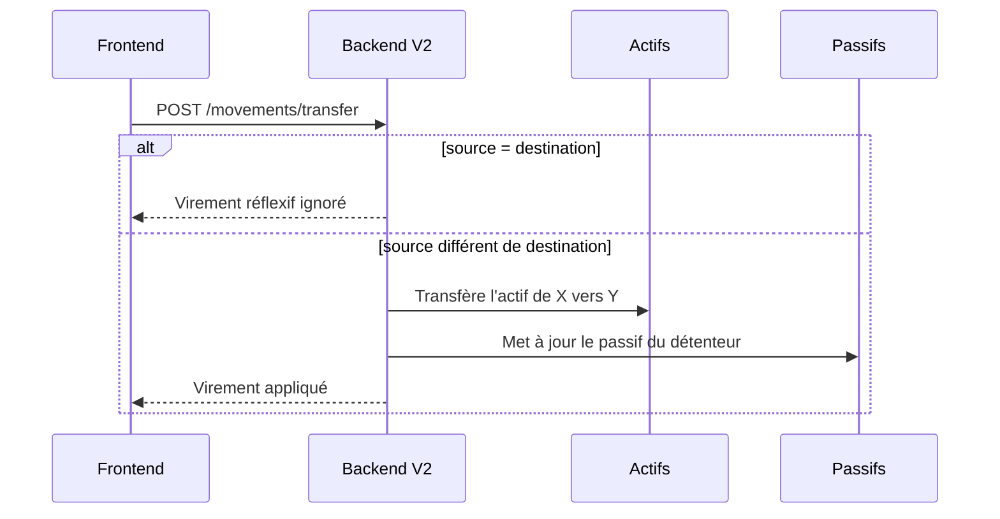
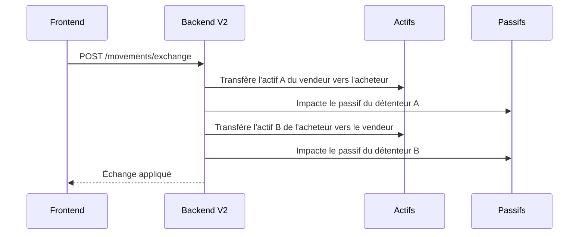
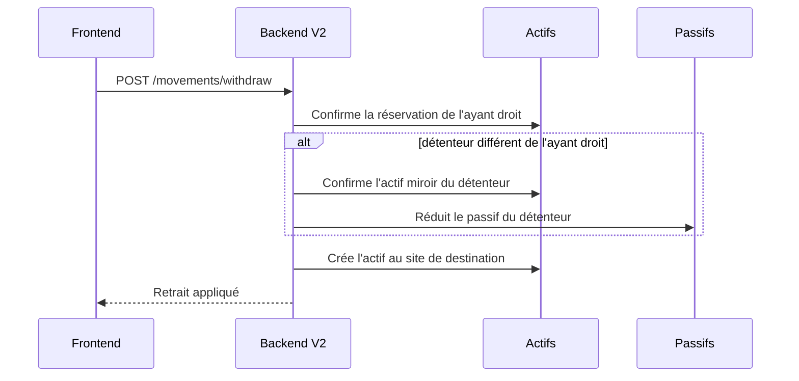

# Tâche Frontend — Intégration des retours « Mouvements » (02/11/2026)

## Contexte
Les fichiers `docs/retour/*.xlsx` décrivent le comportement attendu des mouvements : dépôt, retrait, virement, échange privé et public. Les règles métier sont désormais centralisées côté backend V2 (`/api/v2/movements/...`). Le frontend doit refléter ces règles dans l'affichage et les formulaires.

## Rappels métier
1. **Dépôt** : un membre X dépose un article A chez un détenteur W.
   - Actif créé pour X (ayant droit) chez W.
   - Actif miroir pour W si W ≠ X.
   - Passif de W envers X si W ≠ X.
2. **Retrait** : X récupère son bien chez W.
   - Réservations confirmées, passif de W réduit, actif transféré vers X.
3. **Virement** : changement d'ayant droit chez un même détenteur.
   - Mouvement ignoré si l'ayant droit source = destination.
4. **Échange privé / public** :
   - Les passifs concernés sont ceux des **détenteurs**, jamais des échangeurs.
   - Aucune ligne de passif à quantité 0.
   - Aucun doublon.

## Endpoints V2 disponibles
- `POST /api/v2/movements/deposit`
- `POST /api/v2/movements/transfer`
- `POST /api/v2/movements/exchange`
- `POST /api/v2/movements/withdraw`

Tous protégés par `Authorization: Bearer <accessToken>`.

### Diagramme de séquence — Dépôt


### Diagramme de séquence — Virement de droit


### Diagramme de séquence — Échange


### Diagramme de séquence — Retrait


### Exemple de payload dépôt
```json
{
  "ayantDroitId": "ID_MEMBRE_X",
  "detentaireId": "ID_MEMBRE_W",
  "depotId": "ID_SITE",
  "productId": "ID_ARTICLE",
  "quantite": 250,
  "prixUnitaire": 1000,
  "siteOrigineId": "ID_SITE_ORIGINE"
}
```

## Travail attendu côté frontend
1. **Affichage actifs / passifs**
   - Afficher l'adresse email pour `detentaire` et `ayantDroit`.
   - Ne pas additionner les créances (`ayantDroitId = user`) avec les passifs dont l'utilisateur est débiteur (`userId = user`).
   - Séparer visuellement :
     - « Passifs dont je suis débiteur »
     - « Créances dont je suis bénéficiaire »
   - Contrôler que `total actifs >= total passifs (débiteur)`.

2. **Échanges**
   - Vérifier que les lignes de passifs affichées correspondent aux détenteurs, pas aux échangeurs.
   - Masquer les lignes à quantité 0.
   - Dédoublonner les lignes identiques (produit + dépôt + détenteur + ayant droit).

3. **Formulaires de mouvement**
   - Utiliser les nouveaux endpoints V2.
   - Valider les quantités > 0.
   - Désactiver les champs inutiles quand `detentaireId === ayantDroitId` (pas de passif).
   - Gérer les réponses d'erreur (400 quantité invalide, 401 non authentifié).

4. **Tests de recette**
   - [ ] Dépôt X → W avec X ≠ W : 1 actif X, 1 actif W, 1 passif W envers X.
   - [ ] Dépôt W → W : 1 seule ligne d'actif, aucun passif.
   - [ ] Virement X → Y chez W : actif/passif mis à jour, aucun passif pour X ou Y.
   - [ ] Échange : passifs impactés uniquement côté détenteurs.
   - [ ] Aucun passif à 0, aucun doublon.
   - [ ] Totaux actifs/passifs cohérents.

## Critères d'acceptation
- [ ] Les écrans reflètent les règles ci-dessus.
- [ ] Les totaux sont cohérents (actifs ≥ passifs débiteur).
- [ ] Les cas réflexifs et doublons sont ignorés.
- [ ] Aucune régression sur les écrans existants.
