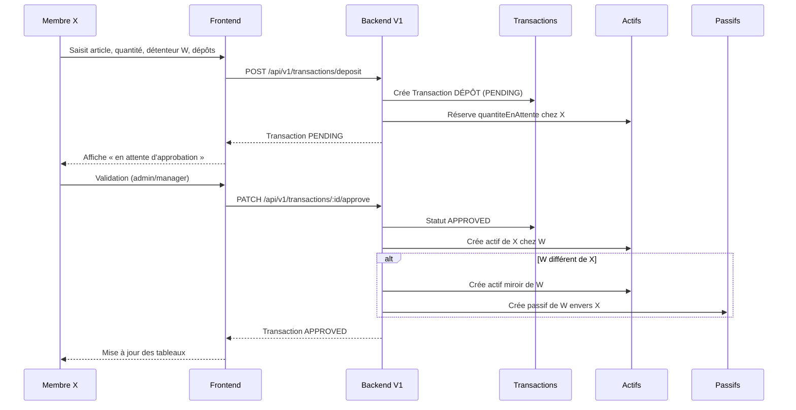
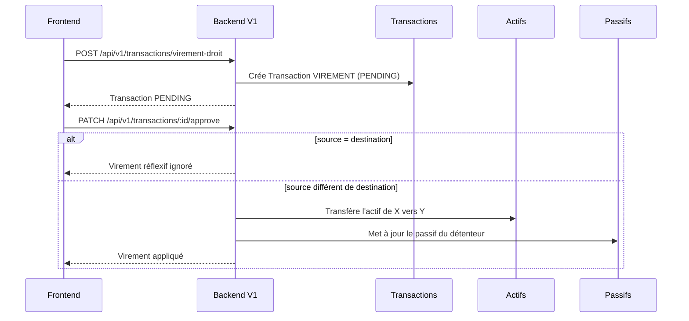
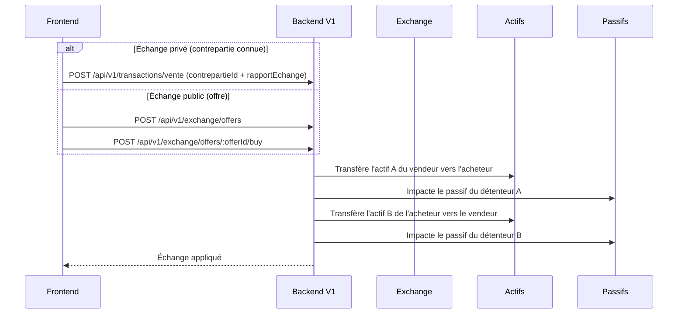
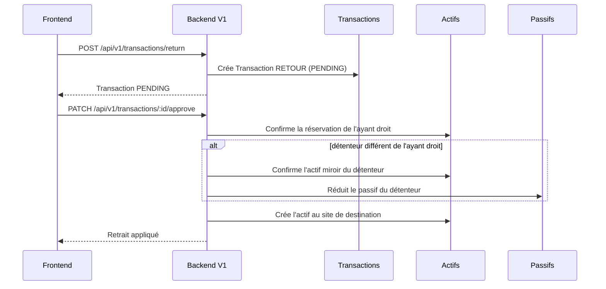

# Tâche Frontend — Intégration des retours « Mouvements » (02/11/2026) — V1

## Contexte
Les fichiers `docs/retour/*.xlsx` décrivent le comportement attendu des mouvements : dépôt, retrait, virement, échange privé et public. Les règles métier sont appliquées côté **backend V1**. Le frontend doit refléter ces règles dans l'affichage et utiliser exclusivement les endpoints V1.

> ⚠️ **Important** : les endpoints V1 créent une `Transaction` en base. C'est ce qui rend les mouvements visibles dans `GET /api/v1/transactions/user/:userId`. Les endpoints V2 (`/api/v2/movements/*`) n'écrivent aucune transaction : ils ne doivent plus être utilisés.

## Rappels métier
1. **Dépôt** : un membre X dépose un article A chez un détenteur W.
   - Actif créé pour X (ayant droit) chez W.
   - Actif miroir pour W si W ≠ X.
   - Passif de W envers X si W ≠ X.
2. **Retrait** : X récupère son bien chez W.
   - Réservations confirmées, passif de W réduit, actif transféré vers X.
3. **Virement** : changement d'ayant droit chez un même détenteur.
   - Mouvement ignoré si l'ayant droit source = destination.
4. **Échange privé / public** :
   - Les passifs concernés sont ceux des **détenteurs**, jamais des échangeurs.
   - Aucune ligne de passif à quantité 0.
   - Aucun doublon.

## Endpoints V1 disponibles
Tous protégés par `Authorization: Bearer <accessToken>`.

### Mouvements (transactions)
| Action | Méthode | Route | DTO |
| --- | --- | --- | --- |
| Dépôt | `POST` | `/api/v1/transactions/deposit` | `CreateDepositDto` |
| Retrait / retour | `POST` | `/api/v1/transactions/return` | `CreateReturnDto` |
| Virement de droit | `POST` | `/api/v1/transactions/virement-droit` | `CreateVirementDroitDto` |
| Vente / échange privé | `POST` | `/api/v1/transactions/vente` | `CreateVenteDto` |
| Initialisation | `POST` | `/api/v1/transactions/initialization` | `CreateInitializationDto` |
| Approbation | `PATCH` | `/api/v1/transactions/:id/approve` | `ApproveTransactionDto` |
| Rejet | `PATCH` | `/api/v1/transactions/:id/reject` | `RejectTransactionDto` |
| Historique utilisateur | `GET` | `/api/v1/transactions/user/:userId?page=1&limit=10&type=DÉPÔT` | — |
| Transactions en attente | `GET` | `/api/v1/transactions/pending/list` | — |

### Échange public (offres)
| Action | Méthode | Route | DTO |
| --- | --- | --- | --- |
| Créer une offre | `POST` | `/api/v1/exchange/offers` | `CreateExchangeOfferDto` |
| Rechercher les offres | `GET` | `/api/v1/exchange/offers` | — |
| Acheter via une offre | `POST` | `/api/v1/exchange/offers/:offerId/buy` | `BuyExchangeOfferDto` |

### Cycle de vie V1
Contrairement à V2 (application immédiate), les mouvements V1 suivent un cycle d'approbation :

```
POST /transactions/{deposit|return|virement-droit|vente}
        ↓
   statut PENDING   (stock mis en attente, aucun mouvement définitif)
        ↓
PATCH /transactions/:id/approve   → statut APPROVED, mouvements actifs/passifs appliqués
   ou PATCH /transactions/:id/reject → statut REJECTED, réservations libérées
```

Le frontend doit donc :
- afficher les transactions `PENDING` comme « en attente » ;
- proposer l'approbation/rejet aux profils habilités ;
- rafraîchir l'historique après approbation.

### Diagramme de séquence — Dépôt


### Diagramme de séquence — Virement de droit


### Diagramme de séquence — Échange


### Diagramme de séquence — Retrait


## Payloads V1

### Dépôt — `POST /api/v1/transactions/deposit`
```json
{
  "detentaire": "ID_MEMBRE_W",
  "ayant_droit": "ID_MEMBRE_X",
  "productId": "ID_ARTICLE",
  "siteOrigineId": "ID_SITE_ORIGINE",
  "siteDestinationId": "ID_SITE_DESTINATION",
  "quantite": 250,
  "prixUnitaire": 1000,
  "observations": "Dépôt commercial"
}
```
- `quantite` > 0 obligatoire ; `prixUnitaire` et `observations` optionnels.
- Attention à l'orthographe V1 : `detentaire` et `ayant_droit` (snake_case), pas `detentaireId` / `ayantDroitId`.

### Retrait — `POST /api/v1/transactions/return`
Même structure que le dépôt :
```json
{
  "detentaire": "ID_MEMBRE_W",
  "ayant_droit": "ID_MEMBRE_X",
  "productId": "ID_ARTICLE",
  "siteOrigineId": "ID_SITE_ORIGINE",
  "siteDestinationId": "ID_SITE_DESTINATION",
  "quantite": 100,
  "prixUnitaire": 1000,
  "observations": "Retrait partiel"
}
```

### Virement de droit — `POST /api/v1/transactions/virement-droit`
```json
{
  "beneficiaryId": "ID_MEMBRE_Z",
  "detentaireId": "ID_MEMBRE_Y",
  "siteId": "ID_SITE_DU_DETENTEUR",
  "productId": "ID_ARTICLE",
  "quantite": 10,
  "observations": "Cession de droit"
}
```

### Vente / échange privé — `POST /api/v1/transactions/vente`
```json
{
  "vendeurId": "ID_VENDEUR",
  "productId": "ID_PRODUIT_ACHETE",
  "siteOrigineId": "ID_SITE_VENDEUR",
  "siteDestinationId": "ID_SITE_ACHETEUR",
  "quantite": 100,
  "contrepartieId": "ID_PRODUIT_CONTREPARTIE",
  "rapportEchange": 2,
  "observations": "Échange Riz contre Maïs"
}
```
- `rapportEchange` obligatoire : prix FCFA/unité (vente monétaire) ou quantité de contrepartie pour 1 unité.
- `contrepartieId` omis ou `null` = vente monétaire.

### Approbation — `PATCH /api/v1/transactions/:id/approve`
```json
{
  "approuveurId": "ID_APPROBATEUR",
  "observations": "Validé"
}
```

### Rejet — `PATCH /api/v1/transactions/:id/reject`
```json
{
  "approuveurId": "ID_APPROBATEUR",
  "motifRejet": "Stock insuffisant"
}
```

### Offre d'échange — `POST /api/v1/exchange/offers`
```json
{
  "productAId": "ID_PRODUIT_A",
  "quantiteA": 10,
  "detentaireAId": "ID_DETENTEUR_W",
  "depotAId": "ID_DEPOT_W",
  "productBId": "ID_PRODUIT_B",
  "tauxEchange": 2,
  "acceptedDetenteurBIds": ["ID_DETENTEUR_Y1", "ID_DETENTEUR_Y2"]
}
```

### Achat d'une offre — `POST /api/v1/exchange/offers/:offerId/buy`
```json
{
  "quantiteA": 3
}
```

## Travail attendu côté frontend
1. **Affichage actifs / passifs**
   - Afficher l'adresse email pour `detentaire` et `ayantDroit`.
   - Utiliser le champ `role` renvoyé par l'API :
     - `"DEBITEUR"` : l'utilisateur est le détenteur → à additionner au total passifs.
     - `"CREANCIER"` : l'utilisateur est l'ayant droit → à afficher séparément.
   - Séparer visuellement :
     - « Passifs dont je suis débiteur »
     - « Créances dont je suis bénéficiaire »
   - Contrôler que `total actifs >= total passifs (débiteur)`.

2. **Échanges**
   - Vérifier que les lignes de passifs affichées correspondent aux détenteurs, pas aux échangeurs.
   - Masquer les lignes à quantité 0.
   - Dédoublonner les lignes identiques (produit + dépôt + détenteur + ayant droit).

3. **Formulaires de mouvement**
   - Utiliser les endpoints V1 listés ci-dessus (pas `/api/v2/movements/*`).
   - Valider les quantités > 0.
   - Désactiver les champs inutiles quand `detentaire === ayant_droit` (pas de passif).
   - Gérer les réponses d'erreur (400 données invalides, 401 non authentifié, 404 transaction introuvable).
   - Après création, rafraîchir la liste `GET /api/v1/transactions/pending/list` et l'historique `GET /api/v1/transactions/user/:userId`.

4. **Tests de recette**
   - [ ] Dépôt X → W avec X ≠ W : transaction PENDING, puis après approbation 1 actif X, 1 actif W, 1 passif W envers X.
   - [ ] Dépôt W → W : 1 seule ligne d'actif, aucun passif.
   - [ ] Virement X → Y chez W : actif/passif mis à jour, aucun passif pour X ou Y.
   - [ ] Échange (vente avec contrepartie ou offre publique) : passifs impactés uniquement côté détenteurs.
   - [ ] Aucun passif à 0, aucun doublon.
   - [ ] Totaux actifs/passifs cohérents.
   - [ ] Le dépôt apparaît bien dans `GET /api/v1/transactions/user/:userId?type=DÉPÔT`.
   - [ ] Rejet : aucune modification d'actif/passif, réservations libérées.

## Critères d'acceptation
- [ ] Les écrans reflètent les règles ci-dessus.
- [ ] Les totaux sont cohérents (actifs ≥ passifs débiteur).
- [ ] Les cas réflexifs et doublons sont ignorés.
- [ ] Les mouvements passent bien par les endpoints V1 avec cycle PENDING → APPROVED/REJECTED.
- [ ] Aucune régression sur les écrans existants.
